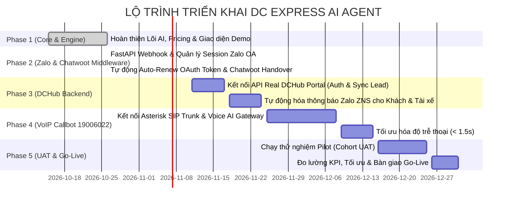

# 🗺️ BẢN ĐỒ CHIẾN LƯỢC & LỘ TRÌNH DỰ ÁN (PROJECT ROADMAP)
## DC Express AI Agent - Tự Động Hóa CSKH, Báo Giá RAG & Lên Đơn Đa Kênh

> **Tài liệu quản trị tiến độ**: Dành cho Ban Giám đốc và Đội ngũ Kỹ thuật nhằm nắm bắt toàn diện bức tranh tổng thể, kiểm soát các mốc bàn giao (milestones), phân bổ nguồn lực và đo lường ROI của dự án.

---

## 1. BỨC TRANH TỔNG THỂ DỰ ÁN (BIG PICTURE & ARCHITECTURE)

### A. Mục tiêu cốt lõi:
- **Tự động hóa 80%** khối lượng công việc tư vấn, tính cước và tiếp nhận đơn hàng vận tải tại DC Express (Đi Chung Express).
- **Phản hồi tức thì (< 3 giây)** trên mọi kênh tiếp nhận: **Zalo Official Account (OA)**, **Website Widget** và **Tổng đài VoIP (19006022 / Asterisk)**.
- **Tối ưu chi phí vận hành (0 VNĐ Token)**: 70% hội thoại chạy bằng LLM mã nguồn mở nội bộ (**Qwen 2.5 7B**); chỉ 30% ca khó/khiếu nại chuyển sang **Gemini 3.8 Flash Cloud AI** với hạn mức Token được kiểm soát nghiêm ngặt.
- **Tự động đẩy Lead & Đơn hàng** lên hệ thống **DCHub Portal (`portal.dichung.vn`)** kèm báo giá (+30% Margin) và kích hoạt điều phối tài xế.

```
                     ┌─────────────────────────────────────────────────────────┐
                     │            KÊNH TIẾP NHẬN KHÁCH HÀNG 24/7               │
                     │    [Zalo OA]  •  [Hotline 19006022]  •  [Website]       │
                     └────────────────────────────┬────────────────────────────┘
                                                  │
                                                  ▼
┌──────────────────────────────────────────────────────────────────────────────────────────────────┐
│ LỚP 1: CORE AI ENGINE & TƯ VẤN TỰ NHIÊN                        │
│ • GĐ 1: Tuyến & Hàng ➔ GĐ 2: Báo giá & Chốt ➔ GĐ 3: Vận hành & Trả ➔ GĐ 4: VAT ➔ GĐ 5: Xác nhận│
│ • Dual Engine: Local Ollama (Qwen 2.5 7B) + Cloud Gemini 3.8 Flash (Interactions API)           │
└─────────────────────────────────┬────────────────────────────────┬───────────────────────────────┘
                                  │                                │
                 (70% Đơn hàng chuẩn hóa)               (30% Khiếu nại / Ca khó)
                                  │                                │
                                  ▼                                ▼
┌───────────────────────────────────────────────────┐ ┌────────────────────────────────────────────┐
│ LỚP 2: MIDDLEWARE VẬN HÀNH & TÍNH CƯỚC RAG        │ │ LỚP 3: HUMAN-IN-THE-LOOP (HỖ TRỢ TRỰC TIẾP)│
│ • DC Express Pricing Engine (+30% Margin)         │ │ • Chuyển giao Chatwoot Live Agent        │
│ • Bóc tách JSON Sạch Payload                      │ │ • Chuyển máy Tổng đài viên (SIP Trunk)   │
│ • Bắn API Lead sang DCHub Portal                  │ └────────────────────────────────────────────┘
│ • Điều phối tài xế (Bắn SMS/Zalo Khách & Tài xế)  │
└───────────────────────────────────────────────────┘
```

---

## 2. TỔNG HỢP NHỮNG VIỆC ĐÃ HOÀN THÀNH (PHASE 1 - STATUS: 100% DONE)

Cho đến thời điểm hiện tại, dự án đã hoàn thành trọn vẹn toàn bộ tầng **Lõi Nghiệp Vụ (Core Business Engine)**, **Giao diện Kiểm thử Tương tác (Streamlit Interactive App)** và **Cơ chế Dual LLM**:

- [x] **1. Kịch bản Tư vấn Tự nhiên 5 Giai đoạn **:
  - Không còn tình trạng xổ một tràng form dài bắt khách điền gây ngợp.
  - Phân tầng rõ rệt: Thu thập 3 thông tin critical ➔ Báo giá & Khách chốt ➔ Lấy thông tin liên lạc & thanh toán (đủ điều kiện vận hành) ➔ Hỏi VAT & Bảo hiểm ➔ Xuất **Phiếu xác nhận đơn hàng (Order Confirmation)**.
- [x] **2. DC Express RAG Pricing Engine (`pricing_engine.py`)**:
  - Tự động nhận diện phân vùng: Nội thành, Liên tỉnh cùng miền (HN ➔ Quảng Ninh), Liên tỉnh khác miền (HN ➔ TP.HCM).
  - Tự động tính cân nặng quy đổi thể tích theo chuẩn logistics: Đường bộ (`/5000`), Đường bay (`/6000`).
  - Áp dụng triệt để công thức: `Giá báo Khách = Giá gốc đối tác + 30% Margin`.
  - Tính toán và cho phép so sánh song song 2 gói dịch vụ: 🚚 **Đường bộ tiết kiệm (DC Road)** và ✈️ **Hỏa tốc đường bay (DC Air)**.
- [x] **3. Trích xuất JSON Sạch Chuẩn API DCHub Portal**:
  - Tự động bóc tách bản tổng kết đơn hàng thành cấu trúc JSON hợp lệ 100% để sẵn sàng bắn API sang `portal.dichung.vn/api/v1/leads`.
- [x] **4. Module Điều Phối Tài Xế (Driver Dispatch Simulation)**:
  - Tích hợp trạng thái xếp chuyến của nhà xe.
  - Mô phỏng cơ chế tự động phát tin nhắn SMS/Zalo cho Khách hàng (thông tin tài xế, biển số xe) và phát lệnh đón hàng cho Tài xế.
- [x] **5. Dual Engine Hybrid (Local 0đ & Cloud)**:
  - Kết nối Local Ollama `qwen2.5:7b` (0đ token).
  - Khắc phục triệt để lỗi model cũ `gemini-2.5-flash` ➔ Tích hợp chuẩn **Google Interactions API (`gemini-3.8-flash`)** mới nhất.
- [x] **6. CI/CD Pipeline Tự Động**:
  - Thiết lập GitHub Actions (`ci.yml`) tự động biên dịch cú pháp Python và kiểm thử tự động thuật toán tính cước Pricing Engine mỗi khi đẩy code.

---

## 3. LỘ TRÌNH CHI TIẾT CÁC BƯỚC TIẾP THEO (MASTER ROADMAP TỚI GO-LIVE)

Lộ trình được chia làm **4 Pha tiếp theo** từ hiện tại đến khi hệ thống vận hành chính thức ngoài đời thực:



---

### 🔹 GIAI ĐOẠN 2: MIDDLEWARE OMNICHANNEL & TÍCH HỢP ZALO OA + CHATWOOT (ƯU TIÊN SỐ 1 - SPRINT TIẾP THEO)
*Mục tiêu: Đưa con bot từ màn hình Streamlit nội bộ ra ngoài Zalo OA thật để khách hàng nhắn tin trực tiếp.*

- [x] **Việc 2.1**: **Phát triển FastAPI Webhook Service (`zalo_middleware.py`)**:
  - Đã hoàn thành core service FastAPI hỗ trợ bất đồng bộ qua `BackgroundTasks` (phản hồi HTTP 200 OK ngay < 100ms cho Zalo OpenAPI, tránh timeout).
  - Tích hợp Dual LLM (Local Ollama & Gemini 3.8 Flash Interactions API) với System Prompt 5 giai đoạn.
  - Tích hợp Pricing Engine (+30% Margin) và trích xuất JSON Lead bắn sang DCHub Portal.
  - Có endpoint giả lập `/simulate/message`, kiểm tra trạng thái `/health`, và quản lý `/sessions`.
- [x] **Việc 2.2**: **Quản lý Hội thoại & Phiên làm việc (Session Management)**:
  - Lưu ánh xạ: `zalo_user_id` ➔ `UserSession` (in-memory, kiến trúc sẵn sàng cắm Redis).
  - Tự động theo dõi và cập nhật trạng thái Giai đoạn từ 1 đến 5 (Stage 1 -> Stage 5).
- [x] **Việc 2.3**: **Tích hợp Tự động làm mới Token (Zalo OAuth Auto-Renew - `zalo_oauth_manager.py`)**:
  - Đã xây dựng module `ZaloOAuthManager`: tự động kiểm tra hạn token, tự động gọi API gia hạn trước 1 giờ khi sắp hết hạn và lưu bảo mật vào `.zalo_tokens.json`.
  - Hỗ trợ đổi Authorization Code (`POST /oauth/exchange-code`), chủ động refresh (`POST /oauth/refresh-token`) và xem trạng thái (`GET /oauth/status`).
- [x] **Việc 2.4**: **Tích hợp Chatwoot Live Agent (Human-in-the-Loop hai chiều - `chatwoot_service.py`)**:
  - Chiều Zalo ➔ Chatwoot: Khi khách yêu cầu gặp nhân viên hoặc khiếu nại ➔ Tự động tạo Contact, tạo Conversation gắn nhãn `[DC_EXPRESS_ESCALATED]`, đẩy toàn bộ lịch sử 5 giai đoạn sang Chatwoot cho tư vấn viên.
  - Chiều Chatwoot ➔ Zalo: Endpoint `POST /chatwoot/webhook` nhận phản hồi của tư vấn viên và tự động bắn tin nhắn trực tiếp về Zalo cho khách hàng.


---

### 🔹 GIAI ĐOẠN 3: KẾT NỐI REAL API DCHUB PORTAL & ZALO NOTIFICATION SERVICE (STATUS: 100% DONE)
*Mục tiêu: Đơn hàng sau khi chốt sẽ tạo thật trên hệ thống CRM/ERP của Đi Chung (`portal.dichung.vn/booking~express`) và đồng bộ trạng thái điều xe.*

- [x] **Việc 3.1**: **Kết nối API Real DCHub Portal (`dchub_service.py`)**:
  - Tích hợp thành công API Staging & Production của Đi Chung Portal (`https://staging.portal.dichung.vn` và `https://portal.dichung.vn`).
  - Xác thực qua header `client: kqab0nar_dltg04o7z5b` chuẩn theo tài liệu Postman Đi Chung.
  - **Tạo Lead (`express_lead`)**: Khi có đủ thông tin địa chỉ 2 đầu, loại hàng và thông tin liên hệ ➔ Tự động tạo Lead với trạng thái **"Có nhu cầu"**.
  - **Tạo Đơn hàng chính thức (Booking)**: Khi khách đồng ý báo giá và chốt đơn ➔ Tự động gọi `POST /api/booking/v1/bookings`, sinh mã đơn hàng thật dạng `DC...` (ví dụ `DC181611`), gắn trạng thái **"Khách chốt"**, tình trạng xe **"Chưa điều"**.
  - **Sao chép thông tin đơn hàng chuẩn 100%**: Hỗ trợ modal popup sao chép đầy đủ: Mã đơn, Người gửi/nhận, SĐT, Địa chỉ lấy/trả, Loại hàng, Mô tả hàng, NET, Thu hộ COD khớp chính xác với giao diện thực tế của `portal.dichung.vn/booking~express`.
  - **Lấy danh sách đơn hàng thực tế**: Kết nối `GET /api/booking/v1/agent/bookings` để hiển thị danh sách đơn hàng thực tế từ DCHub Portal Agent.
- [x] **Việc 3.2**: **Tích hợp Tự động hóa vào Zalo Middleware & Streamlit Dashboard**:
  - `zalo_middleware.py`: Tự động gọi `check_and_create_lead` khi hội thoại đạt giai đoạn 2-3 và gọi `extract_and_push_lead` khi đạt Order Confirmation.
  - `app.py`: Bổ sung bảng mô phỏng DCHub Portal Express Dashboard, cho phép bấm nút tạo Lead, tạo Đơn hàng chính thức, mở popup sao chép đơn và bấm nút "Điều xe" phát thông báo cho tài xế & khách hàng.
- [ ] **Việc 3.3**: **Tích hợp Dịch vụ ZNS (Zalo Notification Service) & SMS Brandname**:
  - Khi nhà xe xếp chuyến thành công trên DCHub Portal ➔ Webhook từ DCHub bắn ngược về Middleware.
  - Middleware tự động gửi mẫu tin ZNS Template được Zalo phê duyệt: *"Đơn hàng DC181580 đã được xếp tài xế [Tên] - [SĐT] - [Biển số]"*.

---

### 🔹 GIAI ĐOẠN 4: TÍCH HỢP TỔNG ĐÀI VOIP ASTERISK (CALLBOT 19006022)
*Mục tiêu: Khách gọi điện đến hotline 19006022, AI tự động nghe máy và nói chuyện tự nhiên bằng giọng người thật.*

- **Việc 4.1**: **Cấu hình Asterisk PJSIP Trunk**:
  - Tạo SIP Trunk kết nối giữa Tổng đài Asterisk nội bộ với Voice Gateway (LiveKit / Vapi / FreeSWITCH).
- **Việc 4.2**: **Pipeline Thoại Real-time (Voice Pipeline)**:
  - **STT (Speech-to-Text)**: Whisper Large v3 Turbo hoặc FPT/Viettel STT (nhận diện giọng vùng miền Bắc - Trung - Nam).
  - **LLM Reasoning**: Qwen 2.5 7B (On-premise) hoặc Gemini 3.8 Flash (Streaming mode).
  - **TTS (Text-to-Speech)**: FPT AI Voice / Viettel AI Voice / ElevenLabs (giọng đọc tự nhiên, ngắt nghỉ đúng chỗ).
- **Việc 4.3**: **Tối ưu độ trễ thoại (Latency Optimization)**:
  - Khống chế tổng độ trễ từ lúc khách dứt lời đến khi bot phát âm thanh < 1.5 giây.
  - Cơ chế phát hiện ngắt lời (Barge-in / Voice Activity Detection - VAD) khi khách ngắt lời bot.

---

### 🔹 GIAI ĐOẠN 5: ĐÓNG GÓI INFRA VPS, BẢO MẬT & ĐÁNH GIÁ CHỈ SỐ KPI GO-LIVE
*Mục tiêu: Triển khai môi trường Production ổn định, an toàn và bàn giao nghiệm thu.*

- **Việc 5.1**: **Đóng gói Docker Compose Toàn diện**:
  - `docker-compose.yml` gồm: `Ollama` + `FastAPI Middleware` + `Chatwoot` + `PostgreSQL` + `Redis` + `Nginx (SSL Let's Encrypt)`.
- **Việc 5.2**: **Giám sát & Quản trị Rủi ro (Monitoring & Quota)**:
  - Cài đặt Prometheus & Grafana theo dõi CPU/RAM VPS, GPU VRAM, số lượng tin nhắn/phút.
  - Khống chế Quota Token Cloud: Giới hạn tối đa 50 USD/tháng cho Gemini Cloud API, tự động cảnh báo qua Telegram/Slack khi vượt 80% ngân sách.
- **Việc 5.3**: **Chạy Thử Nghiệm UAT (Pilot Rollout)**:
  - Thử nghiệm trên 200 khách hàng đầu tiên trên Zalo OA trong 2 tuần.
  - Đo lường các chỉ số thành công (KPIs):
    * **Tỷ lệ hoàn thành đơn tự động (Completion Rate)**: Mục tiêu > 75%.
    * **Thời gian chốt đơn trung bình**: Mục tiêu < 3 phút.
    * **Tỷ lệ chuyển tiếp nhân viên (Handover Rate)**: Khống chế < 25%.
    * **Chi phí Token trung bình trên 1 đơn thành công**: Mục tiêu < 100 VNĐ.

---

## 4. MA TRẬN PHÂN CÔNG & HÀNH ĐỘNG NGAY (IMMEDIATE ACTION PLAN)

Để dự án duy trì tốc độ phát triển nhanh nhất, dưới đây là các đầu việc ưu tiên cần thực hiện ngay trong **Sprint tiếp theo (Tuần tới)**:

| Thứ tự | Đầu việc cụ thể | Phụ trách / Công nghệ | Trạng thái | Sản phẩm đầu ra |
|:---:|---|---|:---:|---|
| **1** | Viết file mã nguồn `zalo_middleware.py` (FastAPI) | Backend / Python | ✅ **Đã hoàn thành** | Core Webhook Service tiếp nhận & phản hồi < 100ms |
| **2** | Tự động làm mới OAuth Token (`zalo_oauth_manager.py`) | Backend / Python | ✅ **Đã hoàn thành** | Auto-renew token trước 1h, lưu `.zalo_tokens.json` |
| **3** | Tích hợp Chatwoot Live Agent (`chatwoot_service.py`) | Fullstack / Python | ✅ **Đã hoàn thành** | Handover 2 chiều giữa Zalo và Chatwoot |
| **4** | Container hóa hệ thống (`Dockerfile`, `docker-compose.yml`) | DevOps | ✅ **Đã hoàn thành** | Khởi chạy 1 lệnh `docker compose up -d` |
| **5** | Đăng ký & Xin cấp quyền Webhook trên Zalo Developer | Quản trị Zalo OA / Đi Chung | ⏳ **Đang triển khai** | Làm theo [ZALO_OA_INTEGRATION_GUIDE.md](file:///Users/minhhh/Downloads/Code/dcexpress-ai-demo/ZALO_OA_INTEGRATION_GUIDE.md) |
| **6** | Kết nối Real API DCHub Portal (`portal.dichung.vn/booking~express`) | Backend / Đi Chung | ✅ **Đã hoàn thành** | `dchub_service.py` tạo Lead 'Có nhu cầu', Đơn 'Khách chốt' (mã DC) & Popup sao chép đơn |
| **7** | Tích hợp Tổng đài VoIP Asterisk (Callbot 19006022) | Voice AI / Asterisk | 📅 **Sprint tiếp theo (Phase 4)** | PJSIP Trunk + Whisper STT + Voice Agent |


---

> 💡 **Khuyến nghị**: Ban dự án có thể sử dụng file [`ROADMAP.md`](file:///Users/minhhh/Downloads/Code/dcexpress-ai-demo/ROADMAP.md) này làm tài liệu theo dõi tiến độ tuần (Weekly Sync Meeting) để đánh dấu các mốc đã hoàn thành (`[x]`) cho đến khi hệ thống chính thức Go-Live!
